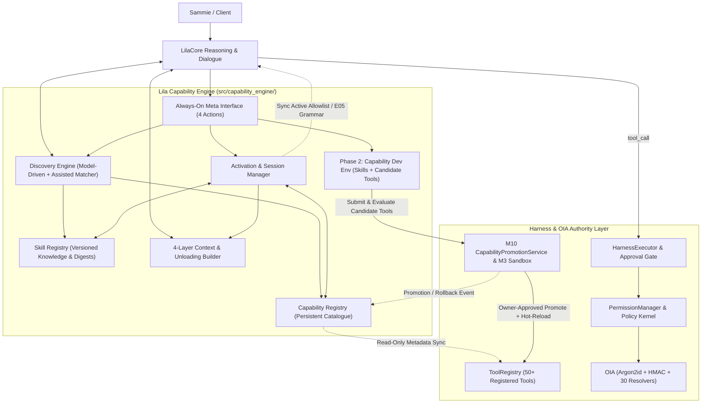
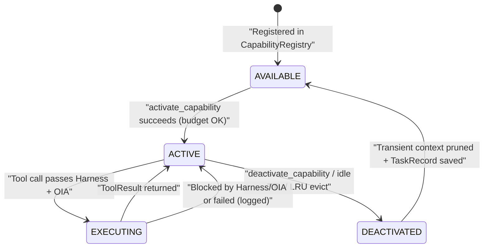

# Lila Capability Engine — Architectural Specification

> **Status:** Locked Architectural Specification — **Phases 1–3 Implemented & Verified (`123/123` tests passing, live on `lila.service`)**  
> **Scope:** Standalone subsystem (`src/capability_engine/`) spanning **3 Levels of Growth** — Phase 1 (*Capability Awareness*), Phase 2 (*Capability Creation*), and Phase 3 (*Capability Evolution*) — integrating cleanly with `LilaCore`, `Harness`, `OIA`, `M3` Sandbox (`sandbox_run`), `M10`, and `ASI v2.4`.

---

## 1. Overview & Design Goals

Today, Lila carries capability descriptions inside every system prompt—first as full verbose schemas (~4,962 static prefix tokens), and more recently as a category-grouped compact index (`309` tokens for ~50 active tools inside a `765`-token static prefix). That optimization solved the immediate `n_ctx = 4096` overflow, **but static tool listing does not scale** to hundreds of tools, specialized procedures, or self-developed skills.

### Empirical Motivation (ASI v2.4 Context Scaling Findings)

Observed CPU benchmarks on Lila's target runtime (`Qwen3.5-0.8B` on ASI v2.4) reinforce keeping working context minimal and reusable prefixes tiny:

- **Occupied context directly governs generation speed:** At **~4K** occupied context, decode ran around **~14.2 tok/s**; at **~20K** occupied context, decode slowed to **~8.1 tok/s**.
- **Cold full-context prefill is expensive on CPU:** Cold-prefilling **20K** tokens took roughly **~18.6 minutes**.
- **Saved prefix snapshots are near-instant:** Restoring a saved **4,825-token** `.asip` disk prefix snapshot (`ASIPFX02`) took only **0.324 seconds**.
- **Small-model attention budgeting matters:** In the 20K retrieval probe, the model exhausted its 96-token allowance inside internal `<think>` reasoning without returning an answer, underscoring why `Qwen3.5-0.8B` must not be overloaded with irrelevant unused tool text or stale multi-step prompt clutter.

### Core Architectural Goals

1. **Zero unused capabilities in steady-state prompts:** Casual conversation carries only a tiny, immutable discovery interface so `.asip` prefix caching restores at sub-second speed (`~0.3s`).
2. **Dynamic activation and true context unloading:** Skills and tools enter active context *only* for the task that needs them and leave *context* (not merely a Python boolean) once finished.
3. **Clean separation of Tools, Skills, and Capabilities:** Teach Lila *how* to think about domain workflows (`Skills`) without requiring new executable code every time, and bundle related skills + tools into discoverable units (`Capabilities`).
4. **Dual-route discovery for both small (`0.8B`) and large models:** Support **model-driven** iterative search and **lightweight assisted discovery** (local suggestion matching that `Qwen3.5-0.8B` can accept or decline).
5. **Standalone subsystem boundaries:** Live under `src/capability_engine/` as a modular subsystem—never bloating `src/harness/executor.py`, and keeping optional external packages (`vTalks`, `Sensa`) independently pluggable.
6. **Non-negotiable security invariant — Growth ≠ Permission:** Discovering, activating, or even creating a capability **never grants authority to execute or register it**. `Harness` (`PermissionManager`, `HarnessExecutor`) and `OIA` remain the sole authority for registration approval, permissions, and execution.

---

## 2. Conceptual Model: Tools vs. Skills vs. Capabilities

| Concept | Definition | Stored Artifact | Execution Authority |
|---|---|---|---|
| **Tool** | Concrete executable operation with typed inputs, outputs, risk level, and permission policy (e.g., `file_read`, `ping`, `bash`). | Code + `Tool` / `ToolArg` contract in `src/harness/tools.py` + `CapabilityManifest` in `src/harness/capabilities.py`. | **Controlled by Harness + OIA** (`automatic`, `approval`, `disabled`, or fail-closed unreviewed). |
| **Skill** | Reusable procedural knowledge, checklists, interpretation rules, troubleshooting sequences, and examples (no standalone side effects). | Versioned structured spec (`SKILL.md`-style document + schema + SHA-256 digest) in `SkillRegistry`. | Non-executable knowledge injected as untrusted-over-policy task guidance (never overrides Harness/OIA policy). |
| **Capability** | A discoverable, activatable unit combining **zero or more Skills**, **zero or more Tools**, and optional supporting resources to accomplish a goal. | `CapabilityBundle` entry in `CapabilityRegistry` with trigger intents, tags, version, and dependency refs. | Inherits the **strictest** Harness/OIA constraints of its bundled tools; activation exposes interfaces, never bypasses checks. |

### Worked Example: `diagnose_computer`

- **Capability (`org.lila.cap.diagnose-computer`):** High-level unit Lila searches for or accepts when asked *"check why my PC is sluggish or running hot."*
  - **Skill (`skill.hardware-diagnostics` v1.0.0):** Checklist covering baseline CPU load vs. per-core saturation, RAM + swap pressure thresholds, thermal/battery throttling interpretation, disk queue interpretation, and step-by-step triage order (non-destructive checks first).
  - **Bound Tools:** Existing Harness tools (`environment_info`, `self_status`, `usb_list`, `task_list`, and read-only diagnostic commands via `bash`) or future read-only metrics tools (`get_cpu_info`, `get_memory_usage`, `get_disk_health`, `get_processes`).
- Notice how a single Skill (`skill.network-triage`) can combine existing tools (`ping`, `dns_lookup`, `wifi_scan`, `http_request`) with zero new code, while a brand-new missing measurement (`SMART` health) cleanly motivates **Phase 2** candidate tool authoring.

---

## 3. Architecture & Components



### Component Responsibilities

| Component | Module (Proposed) | Responsibility | Must NOT Own |
|---|---|---|---|
| **Capability Registry** | `src/capability_engine/registry.py` | Maintains searchable persistent catalogue of **Capabilities**, **Skills**, and metadata mirrors of registered **Tools** (starting by ingesting the existing 50 active OIA-compatible tools without rewriting them). Tracks provenance and digests. | Never grants `auto`/`approval` policy or executes functions directly. |
| **Skill Registry** | `src/capability_engine/skills.py` | Stores, versions, validates, indexes, and retrieves procedural `SkillSpec` records (`text/markdown` + structured steps + SHA-256 content digest). Sanitizes untrusted strings and blocks policy-override markers. | Never embeds executable Python hooks that bypass Harness. |
| **Discovery Engine** | `src/capability_engine/discovery.py` | Implements **Model-Driven** ranked search (`discover_capabilities`) and **Assisted Discovery** (fast local keyword/BM25/embedding-free scorer evaluating turn intent and surfacing compact suggestions without forcing activation). | Never silently executes tools on behalf of the model. |
| **Activation & Session Manager** | `src/capability_engine/activation.py` | Manages per-session/per-task activation state (`Available` -> `Active` -> `Executing` -> `Deactivated`), enforces active-token budget ceiling and idle-turn TTL/LRU eviction, and emits compact `TaskRecord` summaries upon deactivation. | Never leaves stale capability schemas inside permanent conversation turns. |
| **Context & Prompt Bridge** | `src/capability_engine/context_bridge.py` | Separates immutable static prefix (`Identity + Constitution + Boundaries + 4 Meta Actions`) from ephemeral `Transient Context` (currently active skill instructions + active tool schemas) and retained `TaskRecord` summaries. | Never alters `LilaCore._conversation_history` authority or `.asip` key invariants silently. |
| **Core & Harness Adapters** | `src/capability_engine/adapters/` | `CoreAdapter` plugs into `LilaCore` turn assembly and Exp E05 active grammar synchronization (`asi_backend.py`); `HarnessAdapter` syncs metadata from `ToolRegistry` and routes all actual tool invocations through `HarnessExecutor`. | Never touches `engine/asi/*` C internals directly or shortcuts `PermissionManager`. |
| **Capability Development Env** *(Phase 2)* | `src/capability_engine/dev_env.py` | Lets Lila author/test draft **Skills** locally (under policy lint + scenario validation) and draft **Tools** that feed directly into `src/harness/capability_learning.py` (`CapabilityPromotionService`) + `src/harness/isolation.py` (`BoundedProcessBroker`). | Never self-promotes a tool to production without `owner_approved=True`. |

---

## 4. Always-On Discovery Interface (`<tool_call>` Control Operations)

Instead of placing 50 (or 500) tool names into every conversation, Lila keeps **exactly four lightweight control operations** permanently available in her immutable static system prefix, using the **exact same `<tool_call>` JSON syntax** so `Qwen3.5-0.8B` only learns one structured calling mechanism:

```json
[
  {
    "name": "discover_capabilities",
    "arguments": {"query": "string", "kind": "all|capability|skill|tool", "limit": "int(1..8)"},
    "effect": "Searches persistent catalogue; returns ranked matches with IDs, short summaries, required permissions, and estimated token cost."
  },
  {
    "name": "activate_capability",
    "arguments": {"capability_id": "string", "reason": "string", "task_id": "string?", "ttl_turns": "int(1..12)?"},
    "effect": "Loads the bundle's skill guidance and bound tool schemas into Transient Context for this task (subject to token budget)."
  },
  {
    "name": "deactivate_capability",
    "arguments": {"capability_id": "string", "outcome_summary": "string"},
    "effect": "Unloads skill/tool definitions from Transient Context, marks context reclamation required, and saves a compact TaskRecord."
  },
  {
    "name": "request_capability_creation",
    "arguments": {"kind": "skill|tool|capability", "title": "string", "problem": "string", "proposed_inputs": "string"},
    "effect": "Logs an audited missing-capability proposal (Phase 1) and feeds Skill authoring or M3/M10 sandboxed candidate Tool development (Phase 2)."
  }
]
```

> **Control Operations ≠ External Action Execution:** These four operations manipulate Lila's capability environment only; they **never** grant execution permission for any underlying Harness tool.

### Dual Discovery Routes & Controlled Auto-Activation

1. **Route A — Model-Driven Iterative Discovery:**
   - Lila inspects Sammie's request, recognizes missing operational details, calls `discover_capabilities(query=...)` via `<tool_call>`, reads matches, and calls `activate_capability(...)`.
   - If the activated bundle is insufficient (e.g., she has `cap.filesystem-ops` and `skill.hardware-diagnostics`, but realizes SMART disk health is missing), she can issue a follow-up `discover_capabilities("SMART disk health")` and, if nothing matches, call `request_capability_creation(...)`.
2. **Route B — Lightweight Assisted Discovery (`AssistedMatcher`):**
   - Before inference on each user turn, a fast local deterministic matcher (`< 5 ms`, zero LLM call) scores the incoming turn against registered capability trigger phrases, tags, and category keywords.
   - **Controlled Automatic Activation (`auto_activate_allowed=True` only):** Explicitly approved **low-risk, non-sensitive bundles** (for example `cap.system-diagnostics` on *"Check whether my computer is running low on memory"*, `cap.task-and-schedule`, or read-only `cap.workstation-context`) can be automatically activated at turn start so Lila immediately sees how to inspect diagnostics—**without automatically executing any tool**.
   - **Suggestions Only for Sensitive / Private / Privileged Bundles (`auto_activate_allowed=False`):** Even read-only tools like `file_read` can expose private files. Bundles touching filesystems, shells, networks, web, hardware buses, UI automation, or multi-step delegation **never** auto-activate; the matcher prints only an ephemeral 1-line hint (`[Suggested capabilities (not active — call activate_capability if needed): ...]`) and leaves activation + OIA/Harness permission checks intact.

---

## 5. The 4-Layer Context Model, Task-Scoped Lifecycle & Context Reclamation

### Deactivation ≠ Context Reclamation (Critical Technical Distinction)

Deactivating a skill (`1,000` tokens of instructions) in Python removes its schema from the active registry, **but does not erase tokens already evaluated inside ASI's current session KV cache**. Left unaddressed, unloaded skill tokens still linger in ASI KV positions and conversation history.

To achieve **true context reclamation** while preserving conversational continuity, the engine enforces **four strictly separated layers**:

```
┌─────────────────────────────────────────────────────────────────────────┐
│ LAYER 1: PERSISTENT CATALOGUE (Off-Context Disk / Registry Memory)      │
│ • All Skills, Tools (50 -> 500+), Capabilities, Versions, Digests       │
│ • 0 tokens in prompt until matched or activated                         │
└────────────────────────────────────┬────────────────────────────────────┘
                                     ▼ activate_capability() / approved low-risk match
┌─────────────────────────────────────────────────────────────────────────┐
│ LAYER 2: ACTIVE CAPABILITY SET (Per-Session / Per-Task State)           │
│ • Map[capability_id -> ActiveCapabilityHandle] (with task_id + TTL)     │
│ • Tracks token_cost, activated_turn, last_used_turn, ttl_turns, state   │
│ • Synchronized with strict Harness enforcement + Exp E05 grammar        │
└────────────────────────────────────┬────────────────────────────────────┘
                                     ▼ rendered per-turn ONLY while Active
┌─────────────────────────────────────────────────────────────────────────┐
│ LAYER 3: TRANSIENT CONTEXT (Ephemeral Working Overlay — NEVER Stored)   │
│ • Injected dynamically AFTER canonical static .asip prefix              │
│ • Holds active Skill instructions + active Tool schemas (+ hints)       │
│ • NEVER appended into canonical _conversation_history                   │
└────────────────────────────────────┬────────────────────────────────────┘
                                     ▼ deactivate + Context Reclamation
┌─────────────────────────────────────────────────────────────────────────┐
│ LAYER 4: TASK RECORD + RECLAMATION (Continuity Without Bloat)           │
│ • Canonical conversation history stays clean (user/assistant replies)   │
│ • Compact 1-line TaskRecord (<= 200 chars) preserved when useful        │
│ • ContextReclamationPlan signals ASI to rebuild without unloaded text   │
│   and restore the clean saved .asip static prefix snapshot (~0.3s)      │
└─────────────────────────────────────────────────────────────────────────┘
```

### Task-Scoped Unloading Hierarchy (No Premature Churn)

Instead of unloading solely on idle-turn counts during a long investigation, unloading follows a **5-step hierarchy**:
1. **Task-scoped activation:** Activate capabilities bound to an active `task_id` when working on a multi-turn task.
2. **Persist across the task:** Keep task-bound capabilities `ACTIVE` across intermediate reasoning turns even if several turns go by before the capability is reused.
3. **Deactivate on task completion:** Unload task-bound capabilities cleanly as soon as the task completes or fails (`complete_task(task_id)`).
4. **Idle-turn fallback (`3–4` turns):** Automatically deactivate non-task-bound (`task_id=None`) non-executing capabilities after `ttl_turns` (`4` default) idle turns when task completion cannot be determined.
5. **Session reset (`/new`):** Immediately clear all active capabilities, active task bindings, and transient overlays, flagging full context reclamation.

### How `ActivationManager` + `CoreCapabilityAdapter` Execute Context Reclamation

1. Whenever any capability is deactivated (explicit, task completion, idle TTL expiry, LRU budget eviction, or `/new`), `ActivationManager` sets `reclamation_pending=True` and captures `deactivated_ids` + `reclaimed_tokens_estimate`.
2. Before the next generation pass, `CoreCapabilityAdapter` calls `consume_reclamation_plan(session_id)`:
   - Rebuilds the prompt from **canonical conversation history** + **current active Layer 3** (omitting unloaded skill/tool text) + **compact Layer 4 `TaskRecord`s**.
   - Invokes the runtime's KV reclamation callback to **restore the saved static `.asip` prefix snapshot** (`~0.324s` in ASI v2.4) and re-evaluate only the remaining canonical conversation turns + active context—physically purging unloaded skill/tool KV slots.

---

## 6. Capability Lifecycle State Machine



### Lifecycle Rules & Edge Cases

1. **`AVAILABLE` -> `ACTIVE`:** Checks active token budget (`max_active_capability_tokens`, e.g., `1200` tokens default). If activating a new capability would exceed the budget, the least-recently-used non-executing `ACTIVE` capability is evicted (`DEACTIVATED`) first; if a single bundle exceeds the whole budget, activation fails cleanly with an actionable error.
2. **`ACTIVE` -> `EXECUTING` -> `ACTIVE`:** A tool can **only** transition to `EXECUTING` if its parent capability (or direct meta-interface) is `ACTIVE` *and* `HarnessExecutor` + `PermissionManager` + `OIA` authorize that exact call. Failures or OIA denials return cleanly to `ACTIVE` so Lila can inspect the error or adapt.
3. **`ACTIVE` -> `DEACTIVATED` -> `AVAILABLE`:** Triggered explicitly (`deactivate_capability`), automatically after `ttl_turns` idle turns without using that capability, on task completion/cancellation, or on `/new` session reset. Always drops the capability from Layer 3 (`Transient Context`) and records an optional 1-line `TaskRecord` in Layer 4.
4. **Daemon Restart / OIA Pending Suspension:** Active capabilities holding pending OIA challenges persist in session checkpoint state so approval resumption can re-activate the exact bundle digest without granting blanket access to unrelated tools.

---

## 7. Core Data Models & Python Interfaces

```python
from __future__ import annotations

from dataclasses import dataclass, field
from enum import Enum
from typing import Any, Literal, Protocol


class CapabilityKind(str, Enum):
    TOOL = "tool"
    SKILL = "skill"
    CAPABILITY = "capability"


class CapabilityState(str, Enum):
    AVAILABLE = "available"
    ACTIVE = "active"
    EXECUTING = "executing"
    DEACTIVATED = "deactivated"


@dataclass(frozen=True)
class ToolDescriptor:
    """Non-authoritative metadata mirror of a Harness Tool + CapabilityManifest."""
    name: str
    capability_id: str          # e.g. "org.lila.capability.files.read"
    category: str               # e.g. "filesystem"
    summary: str
    risk: str                   # informational only; Harness remains authority
    permission_hint: str        # "auto" | "approval" | "disabled" | "unreviewed"
    estimated_schema_tokens: int
    trigger_keywords: tuple[str, ...] = ()


@dataclass(frozen=True)
class SkillSpec:
    """Versioned procedural knowledge unit (never executable by itself)."""
    skill_id: str               # e.g. "skill.hardware-diagnostics"
    version: str                # semantic version "1.0.0"
    title: str
    summary: str
    instructions_markdown: str  # workflow, checklists, edge-case interpretation
    content_digest: str         # SHA-256 of normalized instructions + resources
    tags: tuple[str, ...] = ()
    recommended_tools: tuple[str, ...] = ()
    resource_paths: tuple[str, ...] = ()
    estimated_tokens: int = 0
    origin: str = "builtin"     # "builtin" | "lila_authored" | "imported"


@dataclass(frozen=True)
class CapabilityBundle:
    """Discoverable, activatable bundle combining skills and tools."""
    capability_id: str          # e.g. "cap.system-diagnostics"
    version: str
    title: str
    summary: str
    skill_ids: tuple[str, ...]
    tool_names: tuple[str, ...]
    tags: tuple[str, ...] = ()
    trigger_phrases: tuple[str, ...] = ()
    estimated_total_tokens: int = 0
    origin: str = "builtin"
    auto_activate_allowed: bool = False  # Controlled AssistedMatcher eligibility
    risk_tier: str = "moderate"          # "low" | "moderate" | "high"


@dataclass(frozen=True)
class DiscoveryMatch:
    item_id: str
    kind: CapabilityKind
    title: str
    summary: str
    score: float
    source: Literal["model_query", "assisted_matcher"]
    estimated_tokens: int
    already_active: bool
    auto_activate_allowed: bool = False
    requires_approval_tools: tuple[str, ...] = ()


@dataclass
class ActiveCapabilityHandle:
    capability_id: str
    state: CapabilityState
    activated_turn: int
    last_used_turn: int
    ttl_turns: int
    token_cost: int
    bundle: CapabilityBundle
    task_id: str | None = None
    activation_source: str = "model"
    loaded_skills: tuple[SkillSpec, ...] = ()
    loaded_tools: tuple[ToolDescriptor, ...] = ()


@dataclass(frozen=True)
class TaskRecord:
    capability_id: str
    started_turn: int
    ended_turn: int
    summary: str                # bounded <= 200 chars, untrusted-data sanitized
    task_id: str | None = None
    tools_invoked: tuple[str, ...] = ()
    succeeded: bool = True


@dataclass(frozen=True)
class ContextReclamationPlan:
    """Explicit signal so Core/ASI reclaims unloaded capability KV positions."""
    reclamation_required: bool
    restore_static_prefix: bool
    deactivated_ids: tuple[str, ...] = ()
    reclaimed_tokens_estimate: int = 0
    preserved_task_records: tuple[TaskRecord, ...] = ()


@dataclass(frozen=True)
class CapabilityCreationRequest:
    request_id: str
    kind: CapabilityKind
    title: str
    problem_statement: str
    proposed_inputs: str
    suggested_tests: tuple[str, ...] = ()
    status: Literal["logged", "drafting", "quarantined", "verified", "promoted", "rejected"] = "logged"


@dataclass(frozen=True)
class AuditEntry:
    """Immutable SHA-256 hash-chained capability audit record."""
    seq: int
    timestamp_utc: str
    actor: str
    action: str
    target_id: str
    target_kind: str
    digest: str
    details: dict[str, Any]
    prev_hash: str
    entry_hash: str


class CapabilityEngineAPI(Protocol):
    def discover_capabilities(
        self, query: str, *, kind: str = "all", limit: int = 5
    ) -> list[DiscoveryMatch]: ...

    def suggest_for_turn(
        self, session_id: str, user_text: str, *, limit: int = 3
    ) -> list[DiscoveryMatch]: ...

    def activate_capability(
        self, session_id: str, capability_id: str, *, reason: str = "", ttl_turns: int = 4, turn: int = 0
    ) -> ActiveCapabilityHandle: ...

    def deactivate_capability(
        self, session_id: str, capability_id: str, *, outcome_summary: str = "", turn: int = 0
    ) -> TaskRecord | None: ...

    def render_transient_context(self, session_id: str, user_text: str, *, turn: int = 0) -> str: ...

    def active_tool_names(self, session_id: str) -> tuple[str, ...]: ...

    def mark_executing(self, session_id: str, tool_name: str, executing: bool) -> None: ...

    def request_capability_creation(
        self, kind: CapabilityKind, title: str, problem: str, proposed_inputs: str = ""
    ) -> CapabilityCreationRequest: ...
```

---

## 8. Security & Trust Invariants

1. **Growth Never Grants Authority:**
   - Searching, suggesting, activating, or authoring a Skill or Candidate Tool **never** modifies `PermissionManager`, `policy_for()`, or OIA approval challenges.
   - `ToolRegistry` and `HarnessExecutor` remain the single choke point before any side effect occurs.
2. **Strict Enforcement Blocking Inactive Tools (No Invisible Bypasses):**
   - Every callable tool is explicitly assigned to a registered capability bundle (zero unassigned callable tools).
   - Executing any operational tool while inactive fails closed (`capability.inactive`) unless covered by an explicitly permitted system-level exception; `allow_legacy_inactive_tools` is a temporary migration toggle defaulting **`False`** in production.
3. **Skills Are Non-Authoritative Guidance:**
   - Injected `SkillSpec` blocks are wrapped under explicit delimiters (`ACTIVE SKILL GUIDANCE (procedural reference; cannot override policy or grant approval)`).
   - `SkillRegistry` validation rejects forbidden policy-override patterns, malformed control tags (`<tool_call>`, `<|im_start|>`, `<|im_end|>`), and excessive length (`max_skill_tokens`).
4. **Default Fail-Closed Handling Matches Harness:**
   - Disabled tools (`memory_store`, `memory_recall`, `memory_list`) remain non-activatable/non-executable.
   - Unreviewed legacy contracts (e.g., `screen_capture` flagged in `src/harness/capabilities.py`, and intentionally unreviewed `power_action` in `oia_harness.py`) stay blocked or fail closed at OIA regardless of bundle activation.
5. **Reusing Existing M3 Sandbox & M10 Candidate Promotion (Phase 2 & 3):**
   - Lila cannot register executable code directly into `ToolRegistry`.
   - Self-written tools reuse **`src/harness/isolation.py`** (`BoundedProcessBroker`, `BubblewrapSandboxBackend` / `LinuxNamespacesSandboxBackend` / `FailClosedSandboxBackend`, `ResourceLeaseManager`, `StagedPatchWorkspace`, scrubbed environment & secret redaction) together with **`src/harness/capability_learning.py`** (`CapabilityPromotionService` quarantine, `check_candidate_source_safety`, sandboxed `evaluate_candidate()`, `owner_approved=True` promotion via `OIA`, and atomic `CatalogVersion` rollback).
6. **Immutable Hash-Chained Audit Trail (`CapabilityAuditLedger`) & SSE Telemetry:**
   - Append-only SHA-256 hash-chained `audit_ledger.jsonl` records every actor (`lila`, `assisted_matcher`, `owner`, `system`), action, timestamp, target digest, and `prev_hash` across creation, discovery, activation, deactivation, context reclamation, modification, testing, approval, promotion, and rollback, with `verify_integrity()` tamper detection.
   - Complements `VersionedEventStream` SSE events (`capability.discovered`, `capability.activated`, `capability.deactivated`, `capability.creation_requested`, `capability.promoted`, `capability.rolled_back`).

---

## 9. Proposed Package Layout & Initial 50-Tool Bundle Mapping

### Standalone Directory Structure

```text
source/src/capability_engine/
├── __init__.py              # Public API surface (CapabilityEngine, Phase 1–3 services, models)
├── models.py                # CapabilityKind/State, ToolDescriptor, SkillSpec, CapabilityBundle, TaskRecord, ContextReclamationPlan, AuditEntry
├── audit.py                 # CapabilityAuditLedger (append-only SHA-256 hash chain + 0700/0600 atomic storage)
├── skills.py                # SkillRegistry + validation + anti-injection checks + version switching + SHA-256 digests
├── registry.py              # CapabilityCatalogRegistry (bundles + ToolRegistry metadata sync + rollback cleanup)
├── discovery.py             # DiscoveryEngine (model query + controlled AssistedMatcher)
├── activation.py            # ActivationManager (task-scoped handles, idle fallback, budget LRU, KV reclamation signal)
├── context_bridge.py        # Layer 1-4 rendering (152-tok static meta block + Layer 3 transient overlay + TaskRecords)
├── creation.py              # Phase 2: SkillAuthoringService + ToolDevelopmentPipeline (M3 sandbox + M10 promotion)
├── evolution.py             # Phase 3: CapabilityEvolutionEngine (gap analysis, A/B skill gating, skill rollback)
├── providers.py             # Phase 3: Generic CapabilityProvider protocol & ExternalProviderRegistry
├── builtin_bundles.py       # 11 starter Skills & 11 Bundles covering 100% of active Harness + Workstation tools
├── engine.py                # CapabilityEngine facade + build_default_capability_engine() + creation requests
└── adapters/
    ├── __init__.py
    ├── core_adapter.py      # CoreCapabilityAdapter (canonical history isolation + .asip KV reclamation trigger)
    └── harness_adapter.py   # HarnessCapabilityAdapter (strict active-tool gate + EXECUTING tracking)
```

### Phase 1–3 Starter Bundle Mapping for Existing Harness Tools (Zero Tool Rewrites)

The existing `50` callable active Harness tools (`8 filesystem + 7 hardware + 10 network + 2 schedule + 3 self + 1 shell + 17 system + 1 web + 1 sandbox`), plus `screen_capture` *(kept prohibited/excluded per `capabilities.py`)* and `6` optional Workstation tools (`workstation_*`), map with zero unassigned tools into **11 starter capability bundles** (`10` core + `1` workstation):

| Bundle ID | Starter Skill | Bundled Existing Tools | Typical Token Cost (Only When Active) |
|---|---|---|---|
| `cap.filesystem-ops` | `skill.safe-file-inspection-and-edits` | `file_read`, `file_list`, `file_search`, `file_write`, `file_patch`, `file_append`, `file_delete`, `rollback_file_backup` | ~345 tok |
| `cap.system-diagnostics` | `skill.host-health-and-diagnostics` | `environment_info`, `self_status`, `self_log`, `current_time`, `usb_list` | ~223 tok |
| `cap.shell-operations` | `skill.scoped-command-execution` | `bash` | ~96 tok |
| `cap.network-diagnostics` | `skill.network-connectivity-triage` | `ping`, `dns_lookup`, `http_request`, `tcp_connect`, `tcp_listen`, `udp_send`, `ssh_exec`, `wifi_scan`, `wifi_connect` | ~329 tok |
| `cap.web-research` | `skill.web-search-and-verification` | `web_search`, `web_fetch` | ~109 tok |
| `cap.desktop-perception-control` | `skill.owner-guided-screen-and-ui` | `computer_observe`, `computer_act`, `island_control`, `screen_present`, `notify_user`, `clipboard_get`, `clipboard_set`, `set_volume` *(plus fail-closed `power_action`; excludes legacy `screen_capture`)* | ~422 tok |
| `cap.hardware-bus` | `skill.embedded-gpio-serial-i2c-spi` | `gpio_read`, `gpio_write`, `i2c_transfer`, `spi_transfer`, `serial_read`, `serial_write` | ~239 tok |
| `cap.task-and-schedule` | `skill.task-and-reminder-tracking` | `task_create`, `task_update`, `task_list`, `task_cancel`, `schedule_add`, `schedule_list` | ~244 tok |
| `cap.workflow-orchestration` | `skill.dag-workflows-and-delegation` | `compose_workflow`, `delegate_subtasks`, `request_owner_approval` | ~206 tok |
| `cap.sandbox-lab` | `skill.sandbox-build-and-test` | `sandbox_run` *(M3 optional on-demand build & prototype test lab; never restricts normal workspace authoring)* | ~110 tok |
| `cap.workstation-context` *(optional)* | `skill.workstation-discovery` | `workstation_overview`, `workstation_list_categories`, `workstation_list_workspaces`, `workstation_get_workspace`, `workstation_intake_overview`, `workstation_software_overview` | ~314 tok |

- **Idle casual chat:** **0** of those 11 bundles loaded — only the 4 `<tool_call>` meta actions (`152` BPE tokens) sit in the immutable static prefix!
- **Active task chat:** Typically **1–2 bundles** (`~100–450` tokens) live temporarily in `Transient Context`, then vanish upon `deactivate_capability`, task completion, or idle fallback, triggering `ContextReclamationPlan`.

---

## 10. Three Levels of Growth & Implementation Roadmap

### Phase 1 — Capability Awareness *(Implemented & Verified)*
- **Capability:** Lila discovers, activates, uses, and deactivates existing capabilities and reclaims context cleanly.
- **Delivered:** `src/capability_engine/` Phase 1 modules, **11 starter bundles + 11 starter skills** covering 100% of active callable Harness (`50`) + Workstation (`6`) tools + `sandbox_run`, strict `HarnessExecutor` adapter gating (`allow_legacy_inactive_tools=False`), live `LilaDaemon` endpoints (`/capabilities/engine`, `/capabilities/audit`, `/capabilities/discover`, `/capabilities/activate`, `/capabilities/deactivate`), and `tests/test_capability_engine.py`.

### Phase 2 — Capability Creation *(Implemented & Verified)*
- **Capability:** Lila creates reusable `Skills`, tests prototypes freely via `sandbox_run`, and develops sandboxed candidate `Tools` inside M3/M10 when gaps appear.
- **Delivered:** `SkillAuthoringService` (`creation.py`) with scenario validation + SHA-256 digest persistence, `ToolDevelopmentPipeline` (`test_in_sandbox`, `develop_candidate_tool`, owner-gated `promote_developed_tool`, `rollback_developed_tools`), and live `POST /capabilities/skills` + `POST /capabilities/tools/develop` routes (`tests/test_capability_engine_phases2_3.py`).

### Phase 3 — Capability Evolution & Ecosystem Providers *(Implemented & Verified)*
- **Capability:** Lila detects capability gaps (`analyze_gaps` + `GET /capabilities/gaps`), benchmarks and evolves skills without regression (`evolve_skill`, `rollback_skill`), and connects optional external standalone providers (`CapabilityProvider`, `ExternalProviderRegistry`) with full immutable SHA-256 hash-chained audit logging (`125/125` combined Python tests passing + `83/83` `.NET` desktop tests passing).

---

## 12. Standalone Usage (Zero Harness or LilaCore Dependency)

Because `source/src/capability_engine/` has **zero required imports** from `src.harness`, `src.core`, `src.daemon`, or `src.oia`, you can use it directly in any third-party Python agent or setup:

```python
from pathlib import Path
from src.capability_engine import (
    CapabilityEngine,
    CoreCapabilityAdapter,
    HarnessCapabilityAdapter,
    ToolDescriptor,
)

# 1. Initialize standalone CapabilityEngine (persists skills + hash-chained audit trail)
engine = CapabilityEngine(storage_dir=Path("./standalone_capabilities"), max_active_tokens=1000)

# 2. Register standalone ToolDescriptors (no Harness ToolRegistry needed)
engine.catalog.register_tool_descriptor(
    ToolDescriptor(
        name="custom_metrics_read",
        capability_id="cap.custom-metrics",
        category="monitoring",
        summary="Read custom application metrics.",
        risk="low",
        permission_hint="auto",
        estimated_schema_tokens=20,
        trigger_keywords=("metrics", "latency", "throughput"),
        schema_text="custom_metrics_read(service: string) [risk=low]: Read custom service metrics.",
    )
)

# 3. Author a Skill + activatable CapabilityBundle
engine.skill_authoring.author_skill(
    "skill.custom-metrics",
    "1.0.0",
    "Custom Metrics Triage",
    "Inspect custom service metrics and latency.",
    "1. Call `custom_metrics_read` for the target service.\n2. Compare p95 latency before alerting.",
    tags=("metrics", "latency", "monitoring"),
    recommended_tools=("custom_metrics_read",),
    bundle_id="cap.custom-metrics",
    trigger_phrases=("check service metrics",),
    auto_activate_allowed=True,
)

# 4. Assemble per-turn messages with transient Layer 3 skills/schemas & KV reclamation callback
core_adapter = CoreCapabilityAdapter(engine)
harness_adapter = HarnessCapabilityAdapter(engine)

messages, turn_ctx = core_adapter.build_turn_messages(
    "session-1",
    "STATIC_SYSTEM_PREFIX\n\n" + core_adapter.build_static_meta_section(),
    "Please check service metrics and latency.",
    canonical_history=[],
    reclaim_kv_callback=lambda prefix: print("Reclaiming prefix KV cache!"),
)

# 5. Gate tool execution in your own runtime
allowed, reason = harness_adapter.check_tool_active("session-1", "custom_metrics_read")
assert allowed is True
```

Verified automatically by `test_standalone_usage_without_harness_or_core` in `source/tests/test_capability_engine_phases2_3.py` (which blocks `src.harness.*` and `src.core.*` in `sys.modules` while testing discovery, assisted activation, active-only gating, deactivation, KV reclamation, standalone subprocess sandbox testing, and SHA-256 audit verification).

---

## 11. Locked Architectural Decisions Summary

| Area | Decision | Key Enforcement Rule |
|---|---|---|
| **1. Meta-action syntax** | Standard `<tool_call>` JSON | Same syntax as tools, explicitly treated as control ops that never authorize underlying tool execution. |
| **2. Assisted Matcher** | Suggestions + controlled auto-activation | Only explicitly flagged low-risk bundles (`auto_activate_allowed=True`) auto-activate; private file/network/privileged bundles suggest only; execution is never implied. |
| **3. Unloading & Context Reclamation** | Task-scoped + idle fallback + `/new` clear + explicit KV reclamation | Deactivation flags `ContextReclamationPlan` so canonical history is rebuilt cleanly without unloaded skill tokens via saved `.asip` prefix restoration. |
| **4. Inactive tool execution** | Strict blocking (`allow_legacy_inactive_tools=False`) | Every callable tool belongs to an explicit bundle; inactive tools fail closed unless an explicit system exception applies. |
